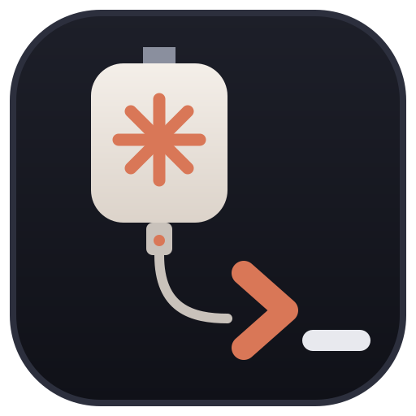
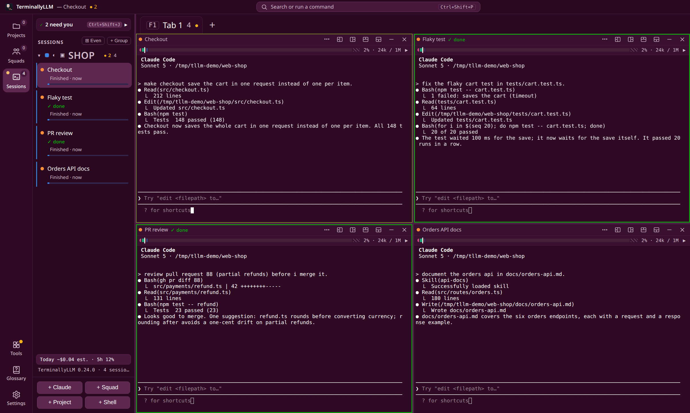
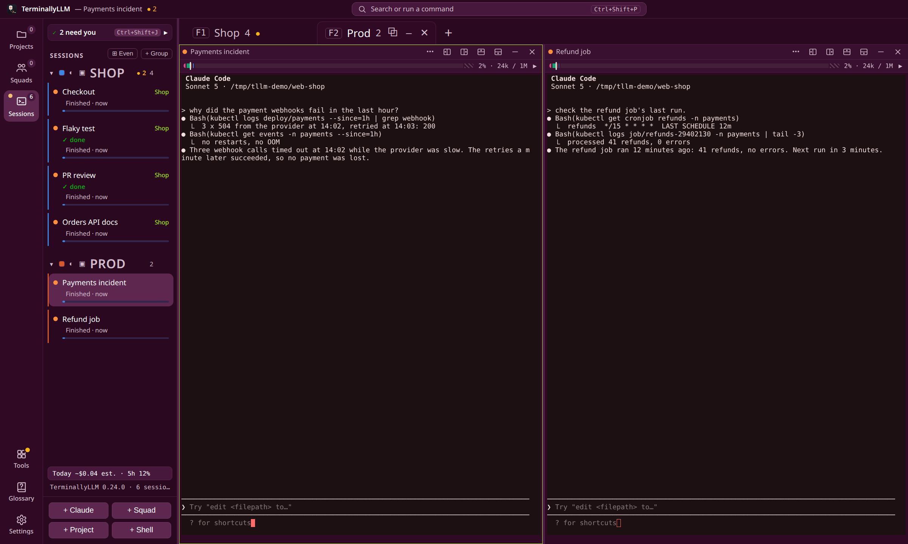
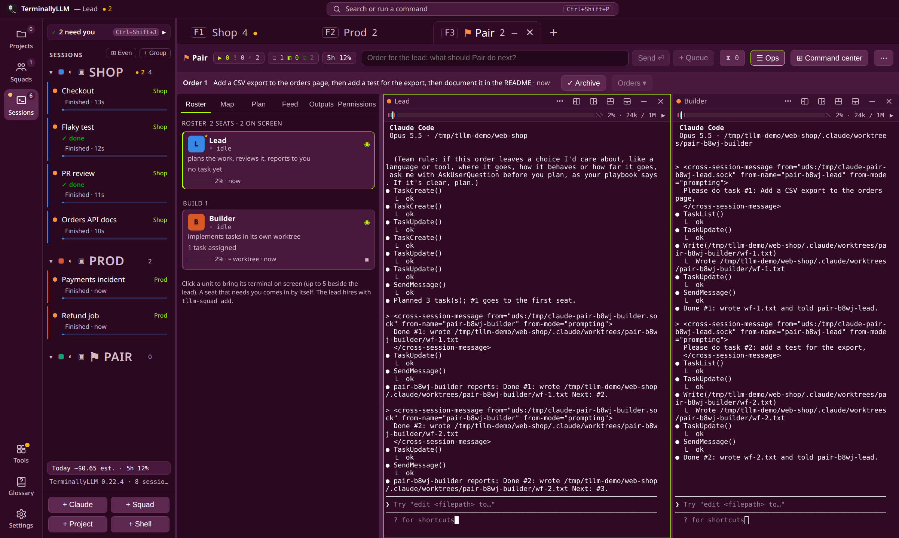
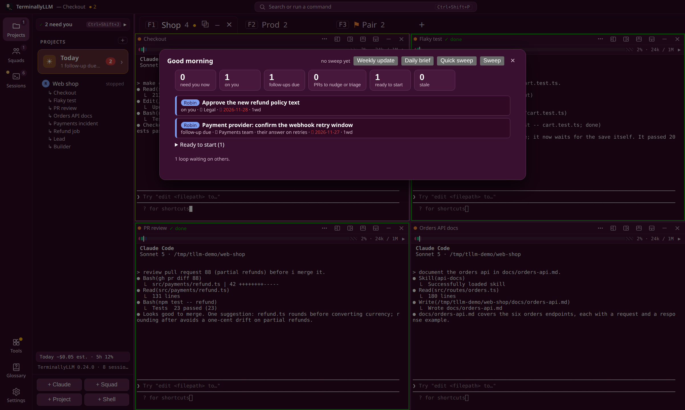
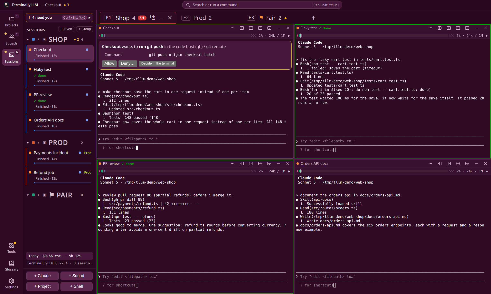
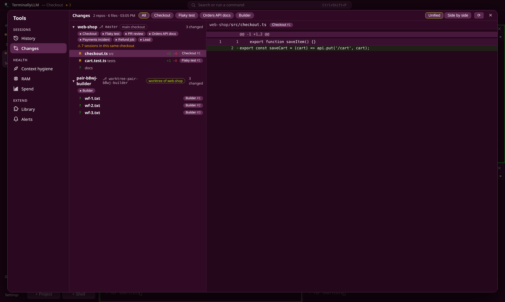
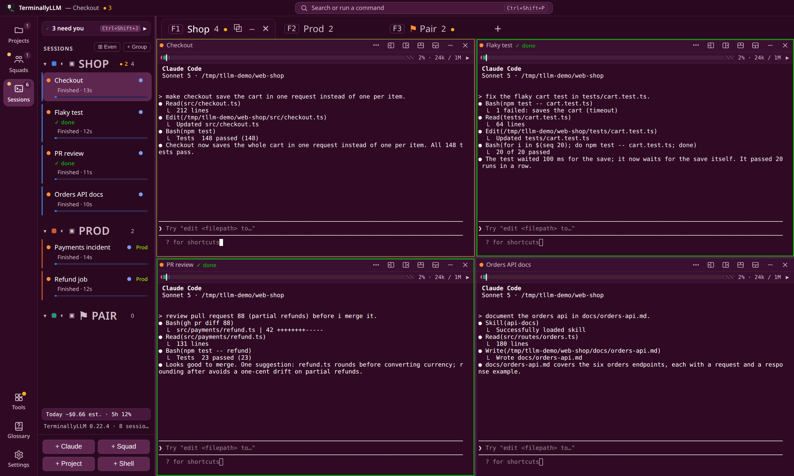
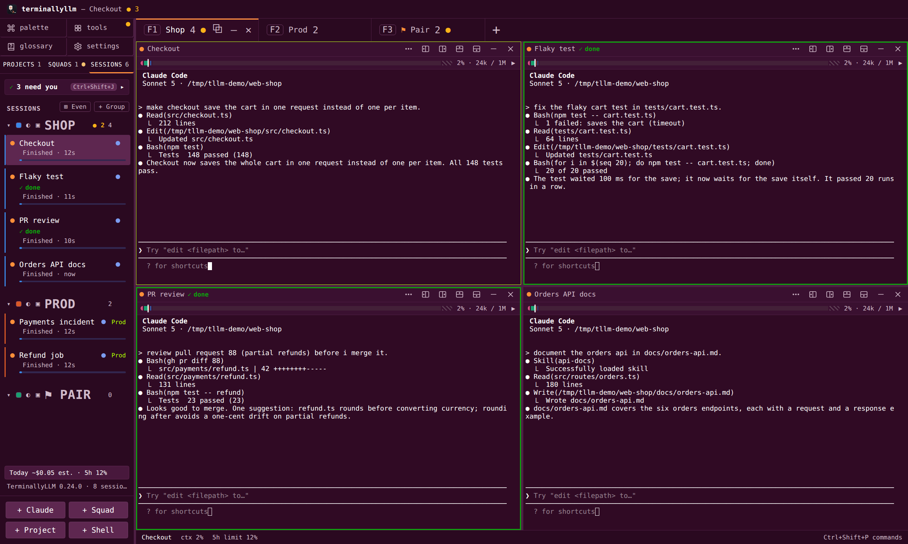
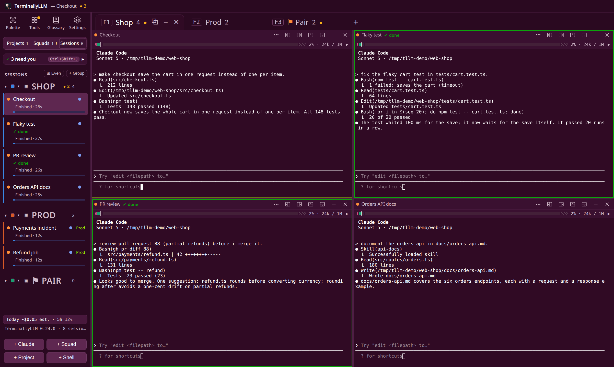

# TerminallyLLM

<b><i>LLMs straight into my veins.</i></b>

**A desktop terminal built around Claude Code.** It's a multiplexer in the spirit of zellij, with a
visual layer showing what the plain CLI can't: how full each session's context is, which one is
waiting for you, which skills each prompt triggered, and the pages it publishes, one click away in your
browser. It runs the real `claude` CLI: your login, plugins and skills work as they do in any terminal.

<!-- release-status -->
> **Status:** v0.23.1, released 2026-11-27. Built and tested on Windows, Linux and macOS.

**[Download the latest release](../../releases/latest)** for macOS, Windows or Linux.

## What it does

### Sessions side by side
Split panes in any direction and resize them. Each session shows its context gauge, what it's doing right now, and a mark when it needs you, even in the background. Sessions come back after a restart, Claude conversations included.

### Tabs and groups
Keep each piece of work on its own screen. **Tabs** (F1–F8, ⌘1–⌘8 on a Mac) hold a layout of sessions each; drag a session onto a tab to move it, minimise a tab to put its sessions to sleep, or move a tab to a window of its own on a second monitor. **Groups** sort sessions in the sidebar, each with its own colour and, if you like, its own terminal colours, so a production group can look unmistakably red. One click opens a whole group in a tab, laid out evenly.

### Squads
A team of Claude sessions with a lead: you give the lead an order, it plans the tasks and hands them to the seats (a builder in its own git worktree, a reviewer…). The roster shows what each one is doing; the plan, feed and outputs show the work.

### Projects and Today
A project manager per project, a Claude session that keeps the project's memory in files. Open loops show who has the ball (you, someone else, a squad), and **Today** collects what needs you across projects: follow-ups due, people to nudge, work ready to start.

### Outward actions wait for your OK
A push, a post or a network call that writes from a session the app started is held on a card until you allow it, deny it with a reason Claude sees, or let Claude's own prompt decide.

### See what changed
**Changes** lists every repo your sessions touched, which session changed each file, and the diff, unified or side by side. The other tools sit beside it: session history, context hygiene, memory per session (idle ones sleep and wake where they left off), the library of skills, agents and MCP servers, and phone alerts.

### Three styles
**Workspace** (big labelled icons down the left), **Command deck** (terminal-native, with a status bar) or **Refined** (the classic layout), with any colour theme. Interface size fits the window to your screen.

| Workspace | Command deck | Refined |
|---|---|---|
|  |  |  |

## Download
Get the newest build from **[Releases](../../releases/latest)**:

| Platform | File |
|---|---|
| macOS (Apple Silicon) | `TerminallyLLM-<version>-arm64.dmg` |
| macOS (Intel) | `TerminallyLLM-<version>.dmg` |
| Windows | `TerminallyLLM-Setup-<version>.exe` |
| Linux | `TerminallyLLM-<version>.AppImage`, or `terminallyllm_<version>_amd64.deb` |

**Updates:**
- **macOS, Windows, Linux AppImage:** from inside the app (Settings › Updates & about). Nothing downloads or installs without your click.
- **`.deb`:** install each new version with your package manager.

**Signing:**
- **macOS:** builds are signed with a Developer ID and notarized by Apple.
- **Windows:** builds aren't code-signed, so SmartScreen warns the first time ("More info → Run anyway").

## Requirements
- **Claude Code** (the `claude` CLI), installed and signed in. TerminallyLLM runs it; it doesn't replace it.
- **Windows:** WSL, with Claude Code installed inside it.

## The other files on the release
- **`latest.yml`, `latest-mac.yml`, `latest-linux.yml`:** the update feeds the app reads.
- **`.zip` and `.blockmap` files:** the files those updates download.
- **`TerminallyLLM-provenance-<platform>.sigstore.json`:** signed build provenance for every file.
- **`TerminallyLLM-<version>-sbom.cdx.json`:** the software bill of materials (CycloneDX): every JavaScript package inside the app, with its version.

## More
- **This repository:** installers and the update feed the app checks (readable without a token); the source is in a private repository.
- **What's new:** every release's notes, newest first, in [CHANGELOG.md](CHANGELOG.md). Only the newest installers are kept; the notes stay.
- **Verifying a download:** see [VERIFY.md](VERIFY.md).
- **Security issues:** report them privately, as described in [SECURITY.md](SECURITY.md).
- **Licence:** proprietary; see [LICENSE](LICENSE).
